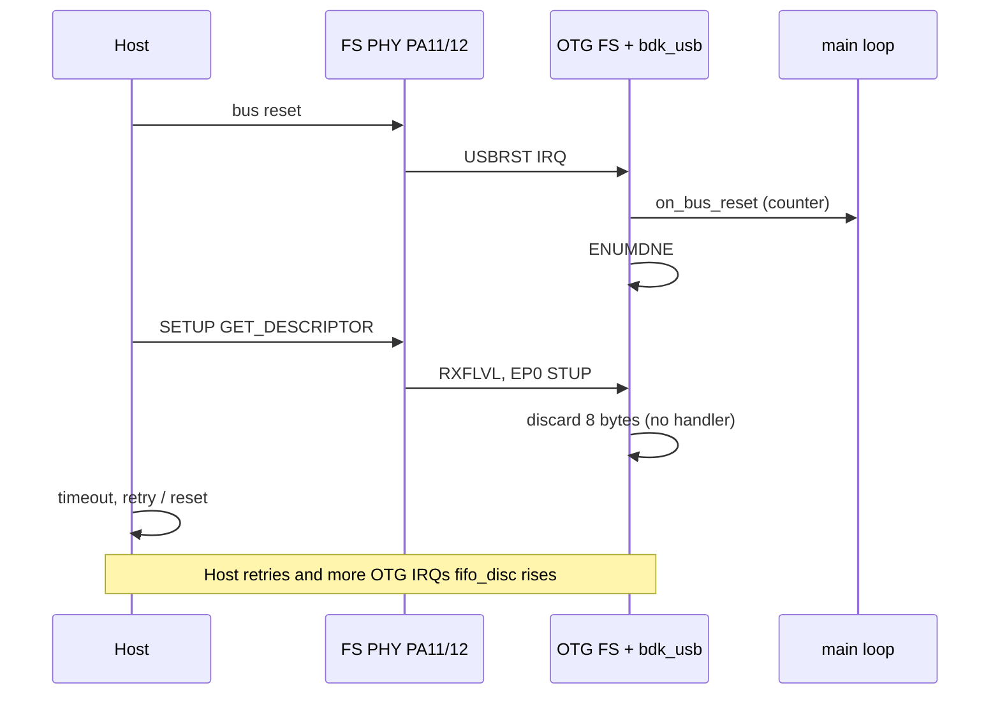

# `usb_bringup` — OTG FS init + host link

**Discovery CN5** — `bdk_rcc`, `bdk_gpio`, `bdk_uart`, `bdk_usb`.

**PHY + soft connect + IRQs** and **host SETUP in the packet FIFO** without a USB device stack on top.

## Build and run

```bash
cmake --build build --target usb_bringup
# flash build/examples/usb/usb_bringup/usb_bringup.bin  (~30 KiB)
```

- **USART2** 115200 (ST-Link): boot banner + `OTG_FS_IRQHandler` / `bdk_usb_irq_stats`
- **CN5** → host: expect `dmesg` “new full-speed USB device”; descriptor read **fails/retries** (expected)

## `main()` init order (`main.c`)

| # | Call | Effect |
|---|------|--------|
| 1 | `usb_clock_init()` | HSE → PLL 168 MHz, **PLLQ = 7** → 48 MHz for USB |
| 2 | `log_redirect_uart2(115200)` | Debug on USART2 |
| 3 | `usb_discovery_cn5_power_on()` | **PC0** high — CN5 power |
| 4 | `usb_fs_dm_dp_init()` | **PA11/PA12** AF `OTG_FS` |
| 5 | `bdk_usb_init(BDK_USB_OTG_FS, &usb_cfg)` | See **Inside `bdk_usb_init`** below |
| 6 | `bdk_usb_set_events(...)` | Optional callbacks: bus reset, enum done |
| 7 | `bdk_usb_irq_enable()` | `NVIC_EnableIRQ(OTG_FS_IRQn)` |
| 8 | `bdk_usb_connect()` | Clear **DCTL SDIS** — device visible on bus |
| 9 | `for (;;)` `poll_usb_events()` | Log NVIC count + IRQ stats (not in ISR) |

**Not used:** `bdk_usb_set_setup_handler` — SETUP packets are **read from RX FIFO and discarded** (`fifo_disc`).

### Inside `bdk_usb_init` (`src/bdk_usb.c`)

| Step | Action |
|------|--------|
| A | `bdk_rcc_usb_otg_fs_clk_enable()` — AHB2 OTG FS clock |
| B | `GUSBCFG.PHYSEL`, core soft reset, `GCCFG.PWRDWN` — embedded FS PHY on |
| C | Force **device mode** (`FDMOD`), `GCCFG` VBUS sense (here: `ignore_vbus_sense`) |
| D | `PCGCCTL = 0`, flush TX/RX FIFOs |
| E | `GRXFSIZ` + `DIEPTXF0_*` — packet RAM: RX 128 words, EP0 IN TX 64 words |
| F | `DCTL.SDIS = 1` until `bdk_usb_connect()` |
| G | `GINTMSK` + `GAHBCFG.GINT` — global IRQ unmasked |
| H | `usb_device_ep0_prepare()` — EP0 masks, arm OUT for SETUP |

## IRQ path (`OTG_FS_IRQHandler`)

```text
OTG_FS_IRQHandler
  └─ bdk_usb_irq_handler()     // loop until GINTSTS & GINTMSK == 0
       ├─ USBRST  → usb_device_on_bus_reset(), on_bus_reset()
       ├─ ENUMDNE → turnaround time, on_enum_done()
       ├─ RXFLVL  → usb_rx_fifo_service()  (discard if no setup handler)
       ├─ OEPINT  → STUP / XFRC on OUT EPs
       ├─ IEPINT  → XFRC on IN EPs (EP0 path if handler registered)
       └─ USBSUSP / WKUINT → clear flags
```

`GINTSTS_*` bits are **local interrupt status**, not USB opcodes. Host **SETUP** shows up as **`RXFLVL`** + bytes in packet FIFO (stats: `rxflvl`, `fifo_disc`, `ep0_stup`).

## Host timeline after you plug CN5



## Done vs still to add

| In place | Still needed for full enumeration |
|----------|-----------------------------------|
| 48 MHz USB clock, CN5 power, DM/DP | EP0 replies (descriptors, SET_ADDRESS, …) |
| Soft connect, `USBRST` / `ENUMDNE` | `bdk_usb_set_setup_handler` + control state machine |
| Host SETUP in FIFO (`fifo_disc`) | Class endpoints + TX FIFO split in packet RAM |
