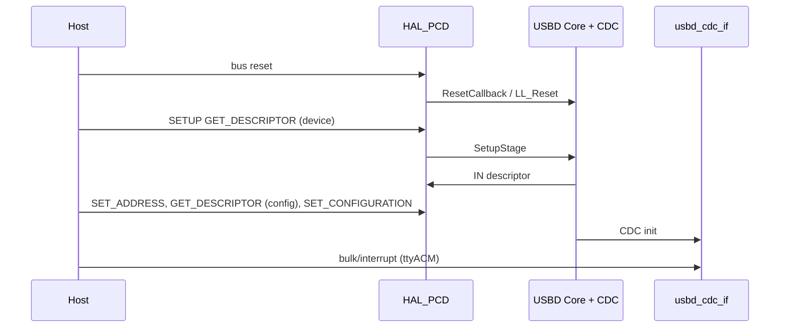

# `usb_example` — HAL PCD + USBD CDC enumeration

**Discovery CN5** — BDK **clock / PC0 / USART2 log**, plus **ST HAL PCD** and **USB Device Library (CDC)**. Cube-style gadget (`0483:5740`).

## Build and run

```bash
cmake --build build --target usb_example
# flash build/examples/usb/usb_example/usb_example.bin  (~40 KiB)
```

- **USART2** 115200: `usb_example: USBD started — plug CN5; …`
- **CN5** on host: `dmesg`, `lsusb` → **0483:5740**, `ttyACM0` (or similar)

Vendored ST code: `vendor/` (trimmed HAL + USBD — see `vendor/README.md` if present).

## `main()` init order (`main.c`)

| # | Call | Effect |
|---|------|--------|
| 1 | `HAL_Init()` | Flash/cache, NVIC grouping, default HAL state |
| 2 | `usb_clock_init()` | BDK: 168 MHz + **48 MHz USB** (PLLQ) |
| 3 | `HAL_InitTick()` | **SysTick** 1 ms — required by HAL/USB stack timing |
| 4 | `log_redirect_uart2(115200)` | Debug |
| 5 | `usb_discovery_cn5_power_on()` | **PC0** high |
| 6 | `MX_USB_DEVICE_Init()` | See below |
| 7 | `for (;;)` | Idle; USB runs on IRQ + USBD |

There is **no** `bdk_usb` in this target.

### `MX_USB_DEVICE_Init()` (`vendor/USB_DEVICE/App/Src/usb_device.c`)

| Step | API | Effect |
|------|-----|--------|
| 1 | `USBD_Init(..., &VCP_Desc, 0)` | → `USBD_LL_Init` → `HAL_PCD_Init` |
| 2 | `USBD_RegisterClass(..., &USBD_CDC)` | CDC class |
| 3 | `USBD_CDC_RegisterInterface(...)` | `usbd_cdc_if.c` |
| 4 | `USBD_Start` | `HAL_PCD_Start` — soft connect, traffic enabled |

### Inside `USBD_LL_Init` / `HAL_PCD_Init` (first time)

| Step | Where | Effect |
|------|--------|--------|
| 1 | `HAL_PCD_MspInit` | **GPIOA** PA9 VBUS, PA10 ID, PA11/12 DM/DP AF; OTG FS clock; **NVIC OTG_FS** |
| 2 | `USB_CoreInit` | Embedded PHY, core reset, transceiver |
| 3 | `USB_SetCurrentMode(DEVICE)` | `FDMOD` |
| 4 | `USB_DevInit` | VBUS policy, FIFO flush, `GINTMSK`, soft disconnect |
| 5 | `HAL_PCDEx_SetRxFiFo` / `SetTxFiFo` | Packet RAM layout (see `usbd_conf.c`: RX 0x80 words, EP0 TX 0x40, EP1 TX 0x80) |
| 6 | `HAL_PCD_Start` | Connect on bus |

**Vectors** (`vendor/stm32f4xx_it.c`):

- `SysTick_Handler` → `HAL_IncTick()`
- `OTG_FS_IRQHandler` → `HAL_PCD_IRQHandler(&hpcd_USB_OTG_FS)`

## IRQ → stack (enumeration)

```text
OTG_FS_IRQHandler
  └─ HAL_PCD_IRQHandler
       ├─ GINTSTS USBRST   → flush, EP0 OUT for SETUP, USBD reset callback
       ├─ GINTSTS ENUMDNE  → speed, turnaround, USBD reset stage
       ├─ GINTSTS RXFLVL   → read GRXSTSP / FIFO
       ├─ GINTSTS OEPINT   → SETUP / OUT complete → USBD_LL_SetupStage / DataOut
       └─ GINTSTS IEPINT   → IN complete → USBD_LL_DataInStage
```

USBD Core handles **GET_DESCRIPTOR**, **SET_ADDRESS**, **SET_CONFIGURATION**, then CDC interfaces.

## Host timeline (successful enum)



## Note on `bdk_usb` + minimal EP0

An experiment that answered SETUP **inside the OTG ISR** without a full stack caused **MCU resets** (boot banner twice). Enumeration on this board stays on **HAL/USBD** here until a complete EP0 + descriptor layer exists in the kit (or a port of USBD LL to `bdk_usb`).
