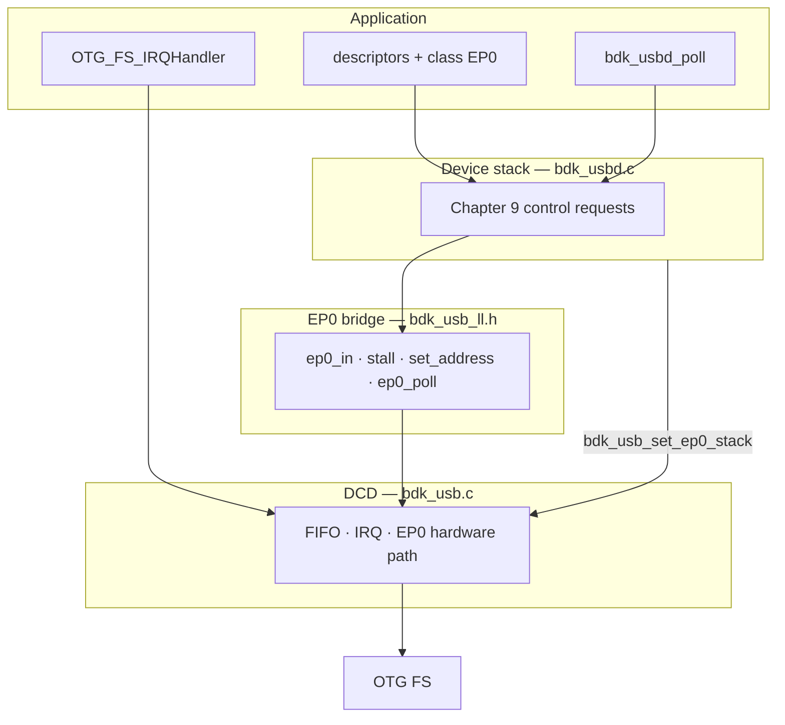

# USB module (`bdk_usb` / `bdk_usbd`)

Headers: [`inc/bdk_usb/`](../../inc/bdk_usb/), CDC in [`inc/bdk_usb/cdc/`](../../inc/bdk_usb/cdc/).

Sources: `bdk_usb.c`, `bdk_usbd.c`, `cdc/bdk_cdc.c`, `cdc/bdk_cdc_desc.c` (in `bdk_stm32f4`).

## Layers

| Layer | Source / header | Responsibility |
|-------|-----------------|----------------|
| **CDC ACM class** | `cdc/bdk_cdc.c`, `cdc/bdk_cdc.h` | Class EP0, default descriptors, open bulk/cmd EPs on `SET_CONFIGURATION` |
| **Device stack** | `bdk_usbd.c`, `bdk_usbd.h` | USB Chapter 9 on EP0; class/config hooks |
| **EP0 bridge** | `bdk_usb_ll.h` (impl in `bdk_usb.c`) | IN data stage, STALL, deferred address, poll deferred SETUP |
| **Device controller (DCD)** | `bdk_usb.c`, `bdk_usb.h` | OTG FS: init, `bdk_usb_ep_open`, IRQ, FIFO, EP0 |
| **Hardware** | — | STM32 USB OTG FS |

Apps use **`bdk_cdc_*`** for VCP-style devices, or **`bdk_usb` only** for bring-up (`usb_bringup`).



```
  Application     descriptors, class handler, IRQ vector, main-loop poll
       │
       ▼
  bdk_usbd        protocol on EP0 (what the host expects during enumeration)
       │  bdk_usb_ll_* 
       ▼
  bdk_usb         peripheral: packets, FIFOs, interrupts
       ▼
  OTG FS
```

## Control path

1. **ISR** — `bdk_usb_irq_handler()` drains the RX FIFO; SETUP is stored and handled later (not in the ISR).
2. **Poll** — `bdk_usbd_poll()` → `bdk_usb_ll_ep0_poll()` → stack decodes SETUP → `bdk_usb_ll_ep0_in()` / stall / deferred address.
3. **Reset** — DCD calls the stack’s `on_bus_reset`; configuration state is cleared.

`bdk_usb` alone (no `bdk_usbd`) — `examples/usb/usb_bringup/`. CDC enumeration: `bdk_cdc` in `examples/usb/usb_cdc/`. Lab notes: [`docs/notes/usb.md`](../../docs/notes/usb.md).
